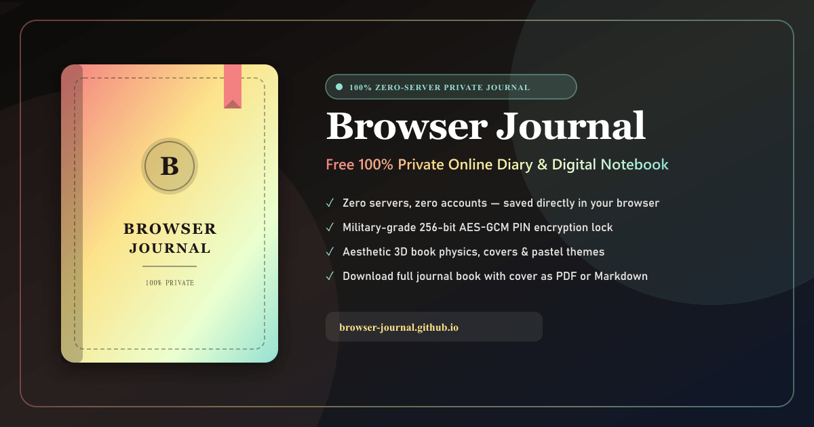

<div align="center">

# 📖 Browser Journal

**A free, 100% private, zero-server daily journaling sanctuary that feels like an authentic hardcover book.**

[](https://browser-journal.github.io)
[](https://browser-journal.github.io)
[](https://browser-journal.github.io)
[](LICENSE)
[](https://ko-fi.com/kishara)

<br />

<p align="center">
  
</p>

<p align="center">
  <b>No accounts. No logins. Zero external servers. Complete client-side encryption.</b><br />
  Everything you write stays strictly inside your device's browser memory.
</p>

---

[Explore Features](#-key-features) •
[Security Architecture](#-security--cryptography-architecture) •
[Tech Stack](#-tech-stack) •
[Project Structure](#-project-structure) •
[Getting Started](#-getting-started) •
[Deployment](#-github-pages-deployment) •
[License](#-license)

</div>

<br />

## 🌟 Overview

**Browser Journal** is an ultra-minimalist, client-side progressive web application designed to bring intimacy, calm, and absolute privacy back to digital journaling. 

Unlike conventional diary platforms that sync your most vulnerable thoughts across cloud databases and parse them for advertising or telemetry, **Browser Journal operates with a strict Zero-Server architecture**. Your entries are stored exclusively in your browser’s `LocalStorage` and can be protected with **military-grade 256-bit AES-GCM encryption** using the native W3C Web Crypto API.

---

## ✨ Key Features

### 📖 Authentic Hardcover Book Experience
- **Realistic 3D Page Turns**: Smooth, physics-based 3D page flip animations when navigating between past and present entries.
- **Customizable Book Covers**: Choose from 8 curated luxury hardcover presets (Pastel Meadow, Antique Tuscan Leather, Midnight Celestial, Pressed Wildflowers, Kyoto Sakura, Nordic Sage, Obsidian Marble, Terracotta Velvet) or **upload your own custom cover image**.
- **Tactile Paper Textures**: Seamlessly switch between **📜 Lined Paper**, **📄 Blank Cream Paper**, or **⠇ Dot Grid** notebooks.
- **Embossed Monograms & Ribbons**: Personalize your diary with custom debossed initials, titles, subtitles, and satin ribbon bookmarks.

### ✍️ Distraction-Free Rich Text Editor
- **Essential Formatting Controls**: Bold, Italic, Underline, Headings (`H1/H2/H3`), Blockquotes, and Bulleted Lists.
- **Responsive Font Size Customizer**: Prominent `A⁻ [18px] A⁺` controls engineered for instant touch adjustments on phones, tablets, and desktops.
- **Emoji & Symbol Palette**: Categorized floating picker with quick search for aesthetic symbols, celestial glyphs, hearts, and emotions.
- **Persistent Text Selection**: Format highlighted text without losing selection or cursor focus.
- **Zen Focus Mode**: 1-click immersive canvas that conceals all sidebars, buttons, and system chrome for uninterrupted stream-of-consciousness writing.

### 🔒 Military-Grade Client-Side PIN Encryption
- **Zero-Server Cryptography**: Powered entirely by the browser’s native `window.crypto.subtle` API.
- **AES-GCM 256-bit Encryption**: Authenticated encryption protects against tampering and unauthorized local inspection.
- **PBKDF2 Key Derivation**: Derives encryption keys from your 4-digit PIN using 100,000 SHA-256 iterations and a cryptographically secure random 16-byte salt.
- **Total Local Secrecy**: If someone opens your browser or inspects disk storage, all notes are indecipherable ciphertext without your PIN.

### 📄 Comprehensive Data Ownership & Export
- **Full Journal Book PDF Export**: Download your entire multi-entry diary compiled into an aesthetic, print-ready PDF book complete with your **custom cover image**, **table of contents**, mood tags, and lined entry pages.
- **Universal Markdown (`.md`)**: Export single entries to clean Markdown with metadata and YAML frontmatter.
- **Plain Text (`.txt`)**: Instant lightweight text downloads.
- **Full JSON Backup Vault**: 1-click export of your complete journal archive and seamless drag-and-drop JSON restoration when migrating to a new phone or computer.

### 🌿 Mood Intelligence & Habit Consistency
- **Daily Mood Pills**: Track emotional energy across 8 states: *Calm*, *Focused*, *Grateful*, *Happy*, *Tired*, *Energized*, *Reflective*, and *Inspired*.
- **Daily Reflection Prompts**: Tap **Inspire Me** to generate curated psychological prompts designed to combat anxiety and spark mindful gratitude.
- **30-Day Heatmap & Streaks**: Real-time habit streak tracker with milestone confetti animations to celebrate consistency.

### 🌐 7-Language Internationalization (i18n)
Full native localization across all UI elements, SEO metadata, reflection prompts, and export tools:
- 🇺🇸 **English** (`en`)
- 🇪🇸 **Español** (`es`)
- 🇧🇷 **Português** (`pt`)
- 🇩🇪 **Deutsch** (`de`)
- 🇫🇷 **Français** (`fr`)
- 🇯🇵 **日本語** (`ja`)
- 🇨🇳 **简体中文** (`zh`)

---

## 🔐 Security & Cryptography Architecture

```
User Enters 4-Digit PIN
         │
         ▼
[PBKDF2 Key Derivation] ◄─── Cryptographic Salt (16 bytes random)
  • SHA-256 Hash
  • 100,000 Rounds
         │
         ▼
  Derived CryptoKey (AES-GCM 256-bit)
         │
 ┌───────┴────────────────────────┐
 │                                │
 ▼                                ▼
[ENCRYPT ON AUTOSAVE]          [DECRYPT ON APP LOAD]
  • 12-byte random IV            • 12-byte stored IV
  • AES-GCM 256-bit              • AES-GCM 256-bit
  • Authenticated Ciphertext     • Decrypted Plaintext
         │                                │
         ▼                                ▼
Encrypted LocalStorage           Interactive Journal Canvas
(Never touches any server)       (Protected in Memory)
```

> [!NOTE]
> **Zero Password Resets**: Because Browser Journal maintains no backend databases or remote telemetry, your encryption keys exist solely in your session memory. Keep your PIN in a secure password manager.

---

## 🛠️ Tech Stack

| Layer | Technology | Rationale |
|---|---|---|
| **Core Framework** | [Astro 5](https://astro.build/) | Static Site Generation (SSG) for sub-second loads and 100/100 Lighthouse performance |
| **Interactive Islands** | [React 19](https://react.dev/) | Isolated client-side state for the book canvas, editor, and encryption engine |
| **Styling** | [Tailwind CSS 3](https://tailwindcss.com/) | Design tokens, custom pastel themes, and CSS 3D transform animations |
| **Typography** | Playfair Display, Plus Jakarta Sans, JetBrains Mono | Editorial typography mimicking fine-bound literary journals |
| **Cryptography** | Web Crypto API (`SubtleCrypto`) | Hardware-accelerated browser-native AES-GCM and PBKDF2 encryption |
| **Icons** | [Lucide React](https://lucide.dev/) | Clean, lightweight SVG iconography |
| **Celebrations** | [Canvas Confetti](https://www.npmjs.com/package/canvas-confetti) | Milestone streak and chapter animations |
| **Image Engine** | [Sharp](https://sharp.pixelplumbing.com/) | High-resolution Open Graph and social card generation |

---

## 📁 Project Structure

```
browser-journal.github.io/
├── public/
│   ├── favicon.svg             # Vector application favicon
│   ├── manifest.json           # PWA standalone manifest
│   ├── og-image.png            # 1200x630 High-res social share card
│   ├── og-image.svg            # Scalable social card graphic
│   ├── robots.txt              # Search crawler directives
│   └── sitemap.xml             # Search engine XML index with hreflang
├── src/
│   ├── components/
│   │   ├── Footer.astro        # Semantic SEO features & FAQ accordion
│   │   ├── JournalApp.tsx      # Main React book island (editor, cover, modals)
│   │   ├── Navbar.astro        # Responsive navigation with single mobile toggle
│   │   └── SEOHead.astro       # Canonical tags, JSON-LD Schemas, and OG tags
│   ├── i18n/
│   │   ├── index.ts            # Locale routing & translation helpers
│   │   └── locales/            # 7 language dictionaries (en, es, pt, de, fr, ja, zh)
│   ├── layouts/
│   │   └── Layout.astro        # Base HTML layout, crawlable H1 & dark mode script
│   ├── pages/
│   │   ├── index.astro         # English root landing page (/)
│   │   ├── [lang]/index.astro  # Localized language landing pages (/es, /de, etc.)
│   ├── styles/
│   │   └── global.css          # CSS 3D book perspective, print styles & themes
│   ├── types/
│   │   └── journal.ts          # TypeScript domain interfaces & dictionaries
│   └── utils/
│       ├── JournalStorage.ts   # LocalStorage persistence & JSON backups
│       ├── cover.ts            # Cover presets, textures, and custom upload logic
│       ├── crypto.ts           # Web Crypto API AES-GCM & PBKDF2 implementation
│       ├── date.ts             # Locale-aware date parsing & streak math
│       ├── emojis.ts           # Categorized emoji dictionary
│       ├── htmlMarkdown.ts     # HTML to Markdown and plaintext serializing
│       ├── pdfExport.ts        # Print-to-PDF book compiler (Cover + TOC + Entries)
│       └── theme.ts            # Pastel themes & dark mode controller
├── scripts/
│   └── generate-og.cjs         # Sharp automated OpenGraph image generator
├── astro.config.mjs            # Astro configuration with i18n and canonical domain
├── package.json
└── README.md
```

---

## 🚀 Getting Started

### Prerequisites
- **Node.js**: `v18.0.0` or higher
- **Package Manager**: `npm`, `pnpm`, or `yarn`

### 1. Clone the Repository
```bash
git clone https://github.com/browser-journal/browser-journal.github.io.git
cd browser-journal.github.io
```

### 2. Install Dependencies
```bash
npm install
```

### 3. Run Development Server
```bash
npm run dev
```
Open **`http://localhost:4321`** in your browser. The app supports instant hot-module reloading.

### 4. Build for Production
```bash
npm run build
```
This runs type verification (`astro check`) and generates fully static, pre-rendered HTML/CSS/JS bundles in the `dist/` directory.

### 5. Preview Static Build Locally
```bash
npm run preview
```

---

## 🌐 GitHub Pages Deployment

The repository includes an automated GitHub Actions deployment workflow at [`.github/workflows/deploy.yml`](.github/workflows/deploy.yml).

To deploy your own fork:
1. Push your changes to the `main` branch.
2. In your GitHub repository, navigate to **Settings > Pages**.
3. Under **Build and deployment > Source**, select **GitHub Actions**.
4. The deployment pipeline will automatically build the Astro static site and publish it to GitHub Pages.

---

## 🎯 Technical SEO & Core Web Vitals

Browser Journal is engineered to achieve **100/100 across all Google Lighthouse metrics**:

- **Performance**: Zero external render-blocking scripts, static HTML pre-rendering, and CSS isolation.
- **Accessibility**: High-contrast ratios, complete keyboard navigation, ARIA landmarks, and touch-target padding.
- **SEO Architecture**:
  - Exact-Match Domain (EMD) targeting `browser-journal.github.io`.
  - Server-rendered semantic `<h1>` tags on all language pages.
  - Complete JSON-LD Structured Data: `WebApplication`, `HowTo`, `FAQPage`, `Organization`, and `BreadcrumbList`.
  - Self-referencing canonical URLs with complete bidirectional `hreflang` language tags.
  - Compliant `sitemap.xml` and `robots.txt`.

---

## ☕ Support & Community

Browser Journal is 100% free, open-source software built for humanity. If it brings peace, clarity, or daily consistency to your life, consider supporting continued development:

👉 **[Support on Ko-fi](https://ko-fi.com/kishara)**

---

## 📄 License

Distributed under the **MIT License**. See [`LICENSE`](LICENSE) for full details.

<div align="center">
  <sub>Crafted with peace, privacy, and reverence for words.</sub>
</div>
